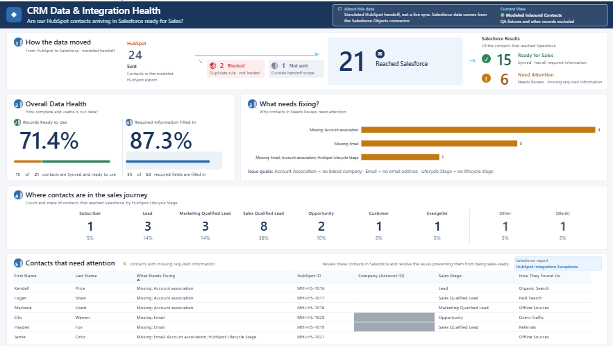
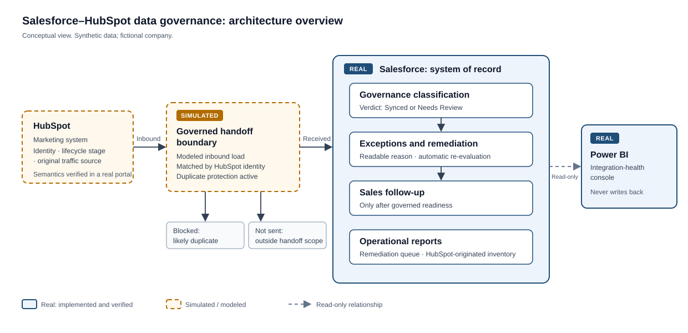
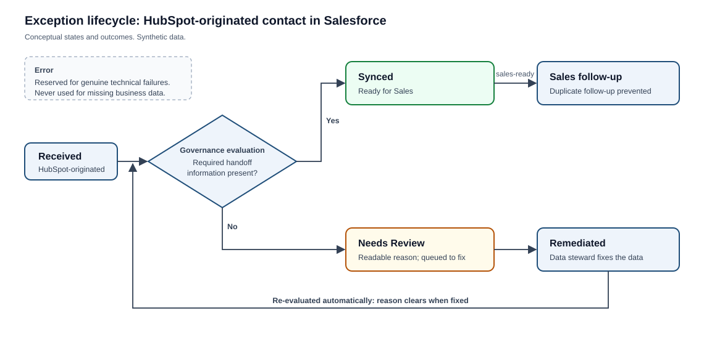

# Salesforce–HubSpot Data Governance: Case Study

How HubSpot-originated contacts are made trustworthy before they reach Sales. The work combines a custom HubSpot → Salesforce integration, governance in Salesforce, exception handling and remediation, sales follow-up, and integration-health analytics in Power BI.

- **The problem:** marketing contacts were reaching Sales incomplete or duplicated, with no clear owner for each field. Reporting on them could not be trusted.
- **What was built:** **Revenue Handoff Integration**, a custom HubSpot → Salesforce integration with governed, approval-controlled data movement; automated classification of every HubSpot-originated contact in Salesforce; readable exceptions that clear themselves when the data is fixed; sales follow-up only for governed, sales-ready contacts; duplicate surfacing; operational reports; and a Power BI integration-health console.
- **What is real:** the integration reads contacts from a real HubSpot developer test account and writes them into a real Salesforce org through a dedicated integration identity. The Salesforce configuration, automation and reporting all ran for real. The integration runs on demand for approved records; it is not a real-time or continuous sync. The Power BI console reports on a separate **modeled** handoff population of synthetic contacts, not on records moved by the integration. The implementation source is private; this repository is a case study.

*Power BI Pipeline Console: integration health for the modeled handoff population (synthetic data). The "simulated handoff" note on the page refers to that population.*

## Executive summary

MeridianCloud Software, a fictional U.S. B2B SaaS company, uses HubSpot for marketing and Salesforce for sales. Contacts passed from one to the other without rules: nobody could say which system owned a field, incomplete records reached sales reps, and duplicates went unnoticed.

A handoff can succeed technically and still deliver a record Sales can't use. This project keeps those two questions apart. The integration moves approved marketing data into Salesforce; Salesforce then decides, independently, whether the contact is ready for Sales. Every HubSpot-originated contact is evaluated as it arrives and whenever it changes. It is either ready for Sales, or it needs review with a plain-language reason.

In a live run, the integration created a fictional contact in Salesforce. Governance flagged it **Needs Review** because it had no linked company account. Once a data steward linked the account, the contact was re-evaluated automatically to **Synced**, and a follow-up check confirmed the integration would not overwrite the steward's fix.

In a modeled handoff of 24 contact submissions, used for the analytics:

- **21** reached Salesforce, **2** were blocked as likely duplicates and **1** was not sent because it was outside the handoff scope.
- Of the 21, **15** were ready for Sales and **6** were flagged for attention with the reason they couldn't proceed.
- The automation also passed a **200-record bulk test** with zero errors.

## The business problem

- **Unclear ownership.** Without a defined system of record per field, marketing updates could overwrite trusted sales data.
- **Incomplete handoffs.** Contacts reached Sales without the minimum information needed to act on them.
- **Invisible exceptions.** Problem records weren't flagged, so they were fixed inconsistently or not at all.
- **Untrustworthy reporting.** Nobody could say how many contacts arrived, how many were usable, or why the rest weren't.

## The solution

| Layer | What it does |
|---|---|
| Revenue Handoff Integration | Reads approved contacts from HubSpot and creates or updates them in Salesforce by their HubSpot identity. It sends marketing data only, through a dedicated integration identity that cannot write governance state or the account association. It never sends ownership; assigning an owner remains a separate Salesforce steward decision |
| Governance classification | Gives every HubSpot-originated contact a verdict, Synced (ready for Sales) or Needs Review, together with the reason |
| Exception remediation | Fixing a flagged record triggers automatic re-evaluation; nothing has to be cleared by hand |
| Sales follow-up | Sales gets a follow-up only once a contact is both governed and sales-ready; duplicate follow-ups are prevented |
| Operational reporting | Salesforce reports give data stewards a remediation queue and an inventory of HubSpot-originated contacts |
| Integration-health analytics | A read-only Power BI console shows how a modeled handoff population moved, how healthy it is and what needs fixing |

## Architecture

| System | Owns | Never does |
|---|---|---|
| HubSpot | Marketing identity, lifecycle stage, original traffic source | Writes Salesforce governance state, ownership or sales activity |
| Revenue Handoff Integration | Moving approved HubSpot marketing data into Salesforce | Writes to HubSpot, or sets governance state, ownership or account association |
| Salesforce | The governance verdict, record ownership, account association, sales activity | Invents marketing identity or attribution |
| Power BI | Integration-health analytics on the modeled population | Writes back to either system |

More: [Architecture](docs/architecture.md)

## Governance capabilities

- **Movement separated from readiness.** The integration delivers data; Salesforce alone decides whether a contact is ready for Sales.
- **Scoped automation.** Automation acts only on contacts that carry a HubSpot identity, so it coexists safely with other work in a shared Salesforce org.
- **Explicit ownership.** Each piece of contact data has a defined owning system, and Salesforce owns the governance verdict.
- **Readable exceptions.** A flagged contact says what is missing in plain language, so a data steward can act without investigating.
- **Self-clearing remediation.** Correcting the data re-evaluates the record automatically and clears the old reason.
- **Governed sales action.** Follow-up goes to Sales only after a contact passes governance and is sales-ready. Duplicate follow-ups are prevented.
- **Duplicate surfacing, not silent merging.** Likely duplicates are blocked or surfaced for a person to review; nothing is merged automatically.
- **Least-privilege integration access.** The integration runs as a dedicated, API-only Salesforce user with a minimal permission set. It can't edit the governance verdict, the exception reason or the account association, and it can't delete records.
- **Controlled data movement.** The integration defaults to a dry run that writes nothing. A live write needs explicit approval for a specific record, and blank HubSpot values never clear Salesforce data.
- **Bulk-safe by design.** Verified at 200 records per transaction; database queries and updates did not grow with the number of records.

## Exception management

For example, a contact arrives without a linked company account. It is marked **Needs Review** with the reason, and it appears in the remediation queue. A data steward links the account; the contact is re-evaluated automatically and becomes **Synced**. If it is sales-ready, Sales receives a follow-up.

More: [Governance and exceptions](docs/governance-and-exceptions.md)

## Analytics

The **Pipeline Console** in Power BI answers one question: *are our HubSpot contacts arriving in Salesforce ready for Sales?* It reports on the modeled handoff population; contacts moved by the custom integration are not included. It has five areas:

- **How the data moved:** 24 submitted, 21 received, 2 blocked, 1 not sent.
- **Overall Data Health:** 71.4% of received contacts are ready to use, and 87.3% of required information is present.
- **What needs fixing?:** missing-information reasons, ranked.
- **Where contacts are in the sales journey:** contacts by HubSpot lifecycle stage.
- **Contacts that need attention:** the worklist, linked to the Salesforce remediation report.

More: [Analytics](docs/analytics.md)

## Verification

Testing ran against the real Salesforce org and HubSpot developer test account with synthetic data. It covered:

- complete and incomplete records;
- remediation of each kind of missing information;
- sales follow-up behavior;
- duplicate handling;
- report accuracy;
- reconciliation of the modeled handoff;
- a **200-record bulk insert and update**, with no errors;
- the custom integration: an offline self-test (**80 of 80**), dry runs that wrote nothing, and a single approved live create, verified by read-back, governance classification and steward remediation;
- regression and cleanup, including a final end-to-end regression.

Every category passed. A read-only verification of the modeled handoff passed **9 of 9** checks.

More: [Testing summary](docs/testing-summary.md)

## Implementation boundary

- **Real:** Revenue Handoff Integration (on demand, HubSpot read-only), the Salesforce configuration, automation, exception handling, reporting and QA, and the Power BI console.
- **Modeled:** the 24-submission handoff population behind the analytics and reconciliation figures.
- **Verified in HubSpot:** contact property names, lifecycle-stage values and original traffic source values, checked in a HubSpot developer test account.
- **Not built:** HubSpot's native Salesforce integration, real-time, continuous or scheduled sync, any write back to HubSpot, HubSpot workflows, production deployment.

More: [Implementation boundary](docs/implementation-boundary.md)

## Technologies

| Area | Used |
|---|---|
| Salesforce | Custom fields on Contact, record-triggered Flows (declarative automation, no Apex), duplicate management (standard rules reused), permission sets, a dedicated API-only integration user, External Client App (OAuth client credentials), REST API upsert by external ID, custom report type and reports, page layout, Salesforce CLI |
| HubSpot | CRM API with read-only contact access; contact property, lifecycle-stage and traffic-source semantics (verified in a HubSpot developer test account) |
| Power BI | Power BI Desktop, PBIP project format, Salesforce Objects connector, semantic model and measures |
| Tooling | Node.js: Revenue Handoff Integration, the modeled handoff load and read-only verification (not published) |

## Skills demonstrated

- Salesforce administration and configuration
- Custom API integration design (HubSpot → Salesforce) with approval-controlled writes
- Declarative automation design, built to be bulk-safe
- CRM data governance and system-of-record design
- Integration identity and least-privilege security design
- Exception management and remediation design
- Duplicate management
- Operational reporting and report troubleshooting
- Power BI semantic modeling and dashboard design
- QA, bulk and regression testing with evidence
- Technical documentation that keeps implemented, verified and modeled work clearly separate

## About this repository

This is a portfolio case study containing documentation, diagrams and screenshots. The implementation is private: Salesforce metadata and automation, the integration source, Power BI source, scripts and datasets. See [NOTICE](NOTICE). All data shown is synthetic.
