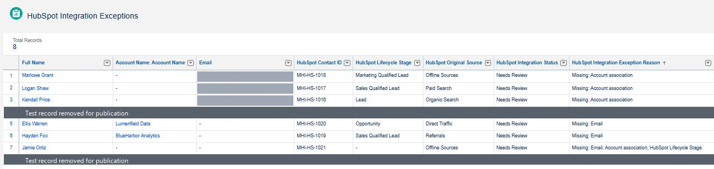
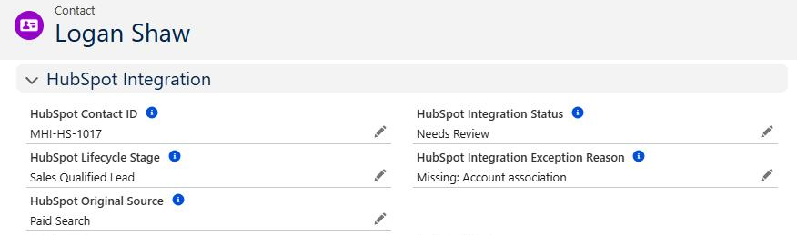

# Governance and Exceptions

## Principle

Every piece of contact data has an owning system. HubSpot owns marketing identity and lifecycle. Salesforce owns the **governance verdict**: the decision on whether a HubSpot-originated contact is ready for Sales. Because only Salesforce can set that verdict, an upstream system can't declare its own data clean.

## Governance states

| State | Meaning |
|---|---|
| **Synced** | Ready for Sales: the contact meets the handoff minimum |
| **Needs Review** | Can't proceed yet. It carries a plain-language reason naming what is missing |
| **Error** | Reserved for genuine technical failures that reach a record. Never used for missing business data |

The handoff minimum is a contact email, a linked company account and a lifecycle stage. These are the same three items the analytics console reports on.

## Exception lifecycle

1. A HubSpot-originated contact arrives and is evaluated.
2. If it meets the handoff minimum, it is **Synced**. Otherwise it is **Needs Review**, with a reason a data steward can act on immediately.
3. Needs Review contacts appear in the Salesforce remediation queue.
4. When the steward corrects the data, the contact is **re-evaluated automatically**. The verdict and reason update themselves, and nobody clears a flag by hand.
5. Once a contact is governed and sales-ready, Sales receives a follow-up.

*Salesforce remediation queue: HubSpot-originated contacts that need attention, with readable reasons.*

*Salesforce governance state on a HubSpot-originated contact awaiting remediation.*

## Business exceptions vs. technical failures

There are two different kinds of problem, and they are handled in different places:

- **Business exceptions:** the record arrived but is incomplete. They live on the record as Needs Review, and a data steward fixes them in Salesforce.
- **Technical failures:** the record didn't arrive, or arrived broken. A blocked submission often has no Salesforce record to flag, so it is accounted for at the boundary, where every submission is reconciled as received, blocked or not sent.

## Sales follow-up

Sales receives a follow-up only when a contact is governed **and** sales-ready. Lifecycle stage alone is not enough: a sales-ready contact with missing information waits in the remediation queue until it is fixed. Duplicate follow-ups are prevented.

## Duplicates

Likely duplicates are blocked at the boundary or surfaced for review. They are **never merged automatically**: deciding whether two records are the same person is a human judgment.

## Example

| Step | Contact state |
|---|---|
| Arrives without a linked company account | Needs Review: missing account association |
| Data steward links the account | Re-evaluated automatically → Synced |
| Contact is sales-ready | Sales receives one follow-up |

*All records are synthetic.*
